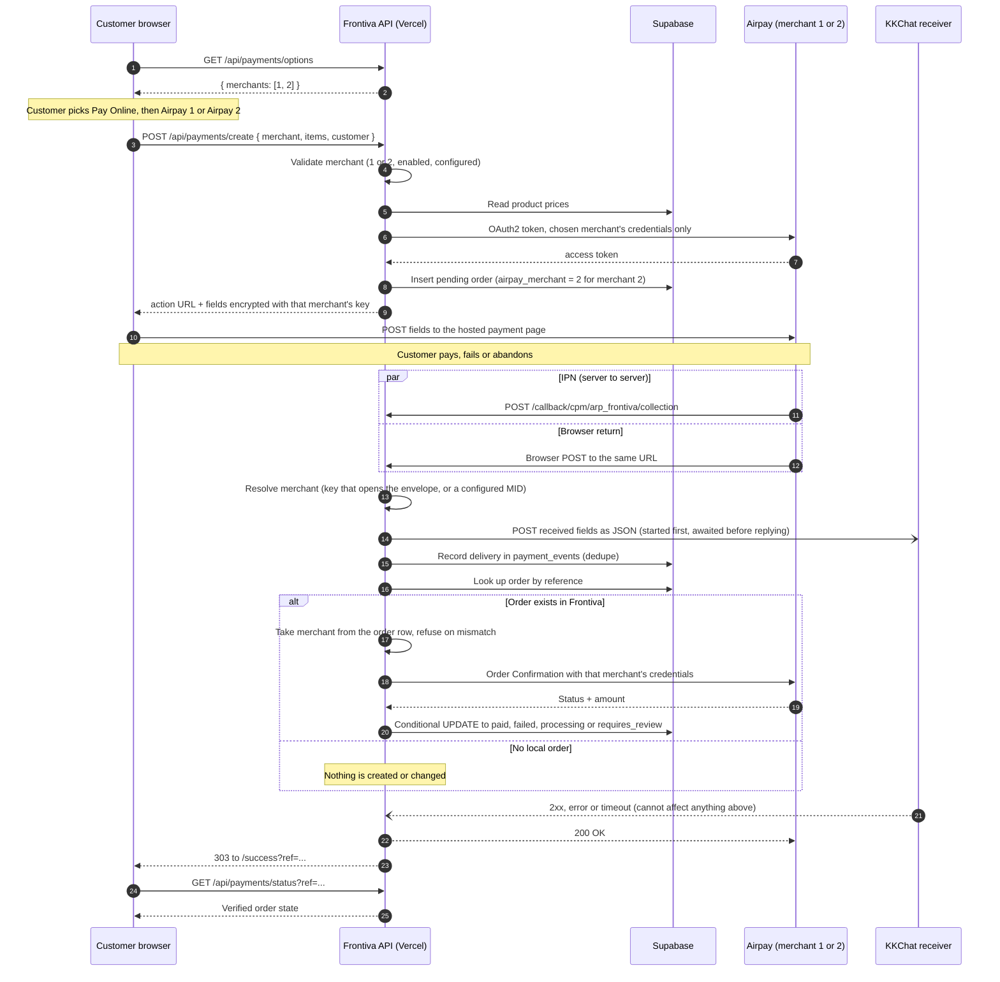

# Frontiva dual Airpay — implementation report

**Branch:** `feat/frontiva-dual-airpay` (from `main` at `bbe1cb7`)
**Date:** 2026-10-13
**Status:** code complete and tested with mocks. Not deployed. No migration has been run against any database. No real payment was made and no Airpay or KKChat endpoint was contacted.

Frontiva checkout can now take an online payment through either of two Airpay merchant accounts. Merchant 1 is the existing account (MID 366751) and behaves as it did. Merchant 2 stays switched off in production until the four blockers in [§19](#19-blockers-before-enabling-merchant-2) are cleared.

Until merchant 2's credentials are set in Vercel, deploying this branch changes nothing a customer can see: the checkout shows the single "Pay Online" option it shows today.

---

## 1. Existing architecture findings

| Area | Finding |
|---|---|
| Repository | The git repository is `store/`. Base branch `main`, clean apart from untracked docs, SQL files and `scripts/`, none of which this work touches. |
| Frontend | React + Vite SPA in `apps/web`. Checkout in `src/pages/CheckoutPage.jsx`, API helpers in `src/api/OrdersApi.js`, confirmation in `src/pages/SuccessPage.jsx`. |
| Backend | Vercel Serverless Functions in `api/`, shared code in `api/_lib/`. Plain JavaScript (ES modules), no framework. |
| Database | Supabase Postgres, reached over PostgREST with `fetch`. Tables `orders` and `payment_events`. |
| Merchant 1 | `AIRPAY_MID` is `366751` in the local server environment, matching the earlier report. |
| Callback | One handler, `api/payments/callback.js`, reached at `/callback/cpm/arp/collection` through a `vercel.json` rewrite. It serves both the browser return and the IPN. |
| Forwarding | `api/_lib/forward-callback.js` POSTs the received fields as JSON to `https://kkchat.in/callback/cpm/arp_frontiva/collection`, once, started before settlement and independent of it. |
| OAuth tokens | Not cached. A new token is requested for every operation. |
| Reconciliation | `api/payments/reconcile.js` exists and is bearer-protected, but **`vercel.json` has no `crons` entry**, so nothing schedules it. |

Three things about the inputs:

- `docs/FRONTIVA_DUAL_AIRPAY_INTEGRATION.md` is, by its own title and content, an analysis of the **AuthenticMedia** codebase, not of Frontiva. It was used as a design reference. Its file paths and line numbers do not exist here.
- The AuthenticMedia repository and the other two blueprint files named in the brief are not in this workspace. Nothing was read from or written to AuthenticMedia.
- That document found no captured Order Confirmation response, and neither did this work. There is still no live-response fixture; see [§8](#8-airpay-order-confirmation-changes).

---

## 2. Final dual-merchant architecture



Design rules that hold throughout:

1. There is no "active merchant". Every function that talks to Airpay is passed the merchant it is for and loads only that merchant's credentials.
2. Merchant 2 never falls back to merchant 1. A missing merchant 2 value is an error for merchant 2.
3. The browser sends a number, `1` or `2`. It cannot send a MID, a credential or a URL.
4. A local order is verified with the merchant written on its own row by the server. A callback cannot choose whose credentials check it.
5. Only an Airpay Order Confirmation response can mark an order paid.
6. Forwarding to KKChat does not depend on the order existing in Frontiva.

---

## 3. Files modified and created

| File | Change |
|---|---|
| `api/_lib/config.js` | `loadAirpayConfig(merchant)`, `parseMerchant`, `isMerchantConfigured`, `configuredMerchants`, `checkoutMerchants`, `callbackPathFor`, `CALLBACK_PATH_FRONTIVA`, `CALLBACK_PATHS`. Removes the argument-less `airpayConfig()`. |
| `api/_lib/airpay.js` | `getAccessToken(merchant)`, `buildPaymentRequest({ ..., merchant })`, `confirmOrder(orderRef, merchant)`. Stricter confirmation parsing. New read-only `confirmExternalOrder`. |
| `api/_lib/orders.js` | `createPendingOrder` records merchant 2. New `merchantForOrder`. `settleOrder` confirms with the order's merchant. |
| `api/_lib/callback-payload.js` | New `resolveCallback` (merchant resolution across both keys) and `extractGatewayOrderId`. |
| `api/_lib/forward-callback.js` | Merchant added to log lines. Redirects are no longer followed automatically. Body, headers and destination unchanged. |
| `api/_lib/http.js` | Merchant 2 credentials added to log scrubbing. |
| `api/payments/create.js` | Reads and validates `merchant`; refuses an unavailable one. |
| `api/payments/callback.js` | Merchant-aware parsing and integrity checks; explicit handling of orders Frontiva does not hold. |
| `api/payments/options.js` | **New.** `GET /api/payments/options`. |
| `api/health.js` | Reports each merchant's state and callback URL; probes merchant 2's OAuth when authorised. |
| `vercel.json` | Rewrite for `/callback/cpm/arp_frontiva/collection`. |
| `apps/web/src/api/OrdersApi.js` | `getPaymentGateways()`; `createOnlinePayment` sends `merchant`. |
| `apps/web/src/pages/CheckoutPage.jsx` | Gateway selector. |
| `migrations-airpay-merchant.sql` | **New.** Additive migration. |
| `supabase-schema.sql` | Same column, so a fresh database matches. |
| `.env.example` | Merchant 2 placeholders and the new optional switches. |
| `tests/dual-airpay.test.js` | **New.** 103 tests. |
| `tests/airpay-oauth.test.js`, `tests/callback.test.js`, `tests/forward-callback.test.js` | Updated for the new function signatures. No assertion was weakened. |

`api/payments/status.js`, `return.js` and `reconcile.js` are unchanged: they call `settleOrder(orderRef)`, which now resolves the merchant itself.

---

## 4. Merchant configuration changes

| Role | Merchant 1 | Merchant 2 |
|---|---|---|
| Merchant ID | `AIRPAY_MID` | `AIRPAY_MID_2` |
| OAuth2 client id | `AIRPAY_CLIENT_ID` | `AIRPAY_CLIENT_ID_2` |
| OAuth2 client secret | `AIRPAY_SECRET_KEY` | `AIRPAY_SECRET_KEY_2` |
| `privatekey` derivation | `AIRPAY_API_KEY` | `AIRPAY_API_KEY_2` |
| AES key and `privatekey` derivation | `AIRPAY_USERNAME`, `AIRPAY_PASSWORD` | `AIRPAY_USERNAME_2`, `AIRPAY_PASSWORD_2` |

Merchant 1's variable names are untouched. `AIRPAY_ENV` and `AIRPAY_VERIFY_URL` are shared by both.

The encryption, checksum, `privatekey` derivation, hosted-page fields, currency and buyer fields are the existing code, unmodified. They already took credentials as parameters; the change is only in which config object is passed in.

---

## 5. Checkout selection

Under "Payment Method", choosing **Pay Online** reveals a second radio group, "Select Payment Gateway", with **Pay with Airpay 1** and **Pay with Airpay 2**. It uses the same button, border and icon styles as the existing payment-method options.

- The group appears only for online payment, and only when the server reports more than one gateway.
- Gateway 1 is selected by default.
- The page asks `GET /api/payments/options` on load. If that fails, it assumes gateway 1 only.
- The choice is checked in the browser and again on the server.
- Cash on Delivery, prices, totals, customer fields and cart behaviour are unchanged. A failed payment start leaves the cart intact and shows the existing error toast.

The UI was verified by the production build and by source-level tests. **It was not opened in a browser during this work.**

---

## 6. Payment initiation flow

`POST /api/payments/create` accepts the existing body plus `merchant`:

```json
{ "merchant": 2, "customer": { "...": "..." }, "items": [{ "product_id": 7, "size": null, "quantity": 1 }] }
```

1. Validate cart and customer (unchanged).
2. Read `merchant`. Absent means `1`, so a cached older checkout page keeps working. Anything other than `1` or `2` is a `400`.
3. If that merchant is switched off or not fully configured, answer `503` with `code: "merchant_unavailable"`. The payment is not moved to the other merchant.
4. Price the order from Supabase (unchanged, identical for both merchants).
5. Request an OAuth token with that merchant's credentials.
6. Insert the pending order.
7. Build the hosted-page fields with that merchant's key and `privatekey`.
8. Return the same response shape as before.

---

## 7. Merchant–order mapping

The merchant is stored in a new nullable column, `orders.airpay_merchant`.

| Stored value | Meaning |
|---|---|
| `NULL` | Merchant 1. This covers every order placed before this change, and every merchant 1 order after it. |
| `2` | Merchant 2. |
| anything else | Not guessed at. Settlement refuses and the order stays as it is. |

Order references keep the existing `FRV…` format for both merchants. A reference prefix was considered and rejected: `FRV2…` cannot be told apart from a base-36 timestamp that happens to begin with `2`, so it is not collision-safe.

Merchant 1 orders deliberately write no value. Merchant 1's insert is therefore the same statement that runs in production today and does not need the new column to exist.

Every path resolves the merchant the same way, from the order row: callback, browser return, `/api/payments/status`, reconciliation, and duplicate or late callbacks.

---

## 8. Airpay Order Confirmation changes

`confirmOrder(orderRef, merchant)` authenticates as that merchant and asks that merchant's account. Three parsing rules were tightened. They apply to merchant 1 as well, and each one can only turn a result into "not verified" (which settles as `requires_review`), never into "paid".

| Rule | Before | Now |
|---|---|---|
| Transport `status` vs transaction status | An outer `"status": "success"` was read in preference to a nested `transaction_status`, so a failed transaction could classify as success. | `transaction_status` (any spelling, any depth) wins. A bare `status` is used only as a fallback and is read from the inner result when there is one. |
| Conflicting fields | Not checked. | `transaction_status` success with a `transaction_payment_status` that is not success is not verified. |
| Echoed order or merchant | Not checked. | If the response names a different `orderid` or `merchant_id`, it is not verified. Absent echoes are accepted. |

**Risk to watch after deploying.** There is no captured live Order Confirmation response to test against. If Airpay's real response differs from the shapes covered in the tests, genuine merchant 1 payments would land in `requires_review` instead of `paid`. The first live merchant 1 payment after deployment should be checked for exactly this ([§17](#17-manual-production-smoke-test-checklist)).

---

## 9. Callback handler and public routes

Both paths reach the same function:

| Public URL | Purpose |
|---|---|
| `https://frontiva.online/callback/cpm/arp_frontiva/collection` | New required path. |
| `https://frontiva.online/callback/cpm/arp/collection` | Existing path, kept. Registered for MID 366751 today. |

Both rewrites sit above the `/api/(.*)` and SPA catch-all rewrites.

How the handler decides which merchant a delivery belongs to:

1. If the body is an encrypted envelope, the merchant whose key decrypts it. This cannot be claimed by the sender.
2. Otherwise, a stated merchant id that equals a configured MID. A MID is public, so this is only a hint.
3. A stated MID that matches neither merchant marks the delivery as foreign. Its envelope is not opened.

That result is used for logging and for one check: if a delivery is about a Frontiva order but names, or was encrypted by, a different merchant than the order's own, it is not acted on. Settlement itself never uses it.

Unchanged behaviour: GET and POST are accepted, form and JSON bodies are parsed, browser and IPN are told apart by request headers, every delivery is written to `payment_events` with a dedupe key, a browser gets a `303` to `/success`, and Airpay gets `200 OK`.

---

## 10. External callback forwarding

Destination: `https://kkchat.in/callback/cpm/arp_frontiva/collection`, overridable with the server-only `KKCHAT_CALLBACK_URL`. Both merchants use it.

Preserved exactly: one POST per received callback, JSON object body with Airpay's own field names, casing and values, encrypted fields left encrypted, 4-second timeout, no retry, the `x-frontiva-forwarded` loop guard, started before settlement, and no effect on settlement whatever the receiver does.

Changed:

- The log lines now include the resolved merchant.
- **Redirects are no longer followed automatically.** A `307` or `308` to the same host over https is followed once. Anything else is logged as `redirect not followed`. If KKChat's endpoint currently answers with a redirect to a different host, forwarding would stop; watch for `airpay.callback.forward.failure` with that error after deploying.

**Trust level of what is forwarded.** The forwarded fields are the callback's own claims. Frontiva does not verify them and adds nothing that says it did. A forwarded `TRANSACTIONSTATUS=200` is not proof of payment. KKChat must confirm with Airpay itself.

What was considered and not built:

- *Verify, then forward a signed status.* The brief's reference document recommends it. It was not built because the relay is deliberately started before any Airpay call (existing tests pin this, after a production incident where the relay was skipped), and because KKChat is not known to validate any such proof. Adding an unvalidated "verified" header would look like protection without being it.
- *Durable retry.* Needs a new table and a scheduled worker. Out of scope here; see [§16](#16-security-observations-and-remaining-limitations).

---

## 11. Callbacks for orders Frontiva does not hold

A callback whose reference is not a Frontiva order (a different format, or `FRV…` but absent from the database) is:

- forwarded to KKChat exactly like any other, before any database access;
- recorded in `payment_events`;
- acknowledged with `200 OK`;
- never used to create or change a row in `orders`.

Forwarding works even if Supabase is unreachable.

Optional check, off by default: with `AIRPAY_VERIFY_EXTERNAL_CALLBACKS=true`, the handler asks Airpay's Order Confirmation about the reference, using the resolved merchant, or both merchants if none was resolved, and logs the outcome as `payment.callback.external_verified`. It writes nothing and does not change what is forwarded. It is off by default because it lets any POST to the public callback URL trigger Airpay API calls.

Not known: what Airpay returns for a reference that a merchant has never seen. The check treats anything without a transaction status as unverified.

---

## 12. Supabase schema changes

One additive migration, `migrations-airpay-merchant.sql`:

```sql
alter table public.orders add column if not exists airpay_merchant smallint;
alter table public.orders add constraint orders_airpay_merchant_check
  check (airpay_merchant is null or airpay_merchant in (1, 2));
```

- Nullable, no default, no backfill, no table rewrite.
- Existing rows are untouched and mean merchant 1.
- Cash on Delivery inserts do not name the column.
- No new table.

**It has not been run anywhere.** Until it is, merchant 1 works normally and a merchant 2 payment fails safely at order creation.

---

## 13. Required environment variables

New, all server-side, none `VITE_`-prefixed:

| Variable | Required | Purpose |
|---|---|---|
| `AIRPAY_MID_2`, `AIRPAY_CLIENT_ID_2`, `AIRPAY_SECRET_KEY_2`, `AIRPAY_API_KEY_2`, `AIRPAY_USERNAME_2`, `AIRPAY_PASSWORD_2` | For merchant 2 | Merchant 2 credentials. All six, or merchant 2 is not offered. |
| `AIRPAY_ENABLED_MERCHANTS` | No | Merchants checkout may start a payment on. Unset means all configured. `1` is the rollback switch. |
| `AIRPAY_CALLBACK_PATH`, `AIRPAY_CALLBACK_PATH_2` | No | Return URL path each merchant sends. Defaults: old path for merchant 1, new path for merchant 2. Only the two served paths are accepted. |
| `AIRPAY_VERIFY_EXTERNAL_CALLBACKS` | No | See [§11](#11-callbacks-for-orders-frontiva-does-not-hold). |

Existing variables are unchanged and none was removed.

The local development `.env` already defines all six merchant 2 names. Whether they are set in the Vercel project was not checked.

---

## 14. Airpay dashboard configuration per MID

No dashboard was viewed or changed during this work.

| | Merchant 1 (MID 366751) | Merchant 2 |
|---|---|---|
| Domain | `https://frontiva.online` | `https://frontiva.online` |
| Response URL | `https://frontiva.online/callback/cpm/arp/collection` (as documented today; **no change needed**) | `https://frontiva.online/callback/cpm/arp_frontiva/collection` (**must be set**) |
| IPN URL | same as its Response URL | same as its Response URL |

To move merchant 1 to the new path later: change its dashboard first, then set `AIRPAY_CALLBACK_PATH=/callback/cpm/arp_frontiva/collection` and redeploy. Both paths stay live, so there is no window in which a callback is lost.

If merchant 2's dashboard points somewhere else, for example directly at KKChat, Frontiva will not receive its callbacks. Orders would then be settled only by the success page or by reconciliation, and Frontiva would forward nothing for that merchant.

---

## 15. Test and build results

Run from `store/` on Windows, Node 24.18.0.

| Command | Result |
|---|---|
| `npm test` (before changes were complete, existing suite on the refactor) | 291 passed, 0 failed |
| `node --test tests/dual-airpay.test.js` | 103 passed, 0 failed |
| `npm test` (final) | **394 passed, 0 failed** |
| `npm run lint` | exit 0, no findings |
| `npm run build` | exit 0, 2055 modules |
| `grep -rlE "AIRPAY_\|VITE_AIRPAY\|CRON_SECRET\|kkchat\|kraken\.airpay" dist/apps/web/` | no matches |

No type checking is configured in this repository. `npm run lint` covers `apps/web` only; the files under `api/` are not linted by any existing script.

All tests use an in-process `fetch` stub standing in for Airpay, Supabase and KKChat, with made-up credentials. What the new tests cover: merchant selection and rejection, missing merchant 2 configuration, credential and token separation, encryption with the right key, server pricing, merchant recorded on the order, historic orders, callbacks for each merchant in plaintext and encrypted form, wrong or unknown merchant, unreadable, empty and malformed bodies, forged success, duplicate IPN plus browser return, orders with no local row, forwarding destination, body fidelity, loop guard, receiver error and timeout, redirects, settlement outcomes per merchant, amount mismatch, Airpay unreachable, conflicting confirmation fields, and the status endpoint.

---

## 16. Security observations and remaining limitations

**Outside this change, and not fixed by it**

1. **Open RLS policy on `orders`.** `supabase-schema.sql` grants `for all using (true) with check (true)`. Anyone holding the public anon key, which ships in the browser bundle, can read every order with its customer name, phone and address, and can update any row, including setting `payment_status` to `paid`. This predates the dual-merchant work and makes every server-side payment check bypassable at the database. It should be fixed before relying on payment status for fulfilment.
2. **No reconciliation schedule.** With no cron, an order whose callback is lost and whose customer never returns stays `initiated` indefinitely. This applies to both merchants.
3. **`ap_SecureHash` is advisory.** Unchanged; a mismatch is logged and does not block unless `AIRPAY_ENFORCE_SECURE_HASH=true`.

**Limitations of this change**

4. Forwarded callbacks are unverified, as described in [§10](#10-external-callback-forwarding). A forged POST to the public callback URL is forwarded to KKChat. This is the existing behaviour, now for two merchants.
5. Forwarding is one attempt. A KKChat outage loses that notification. Airpay's own redelivery is the only retry.
6. The Order Confirmation response shape is unconfirmed ([§8](#8-airpay-order-confirmation-changes)).
7. The public `/api/payments/options` endpoint reveals whether a second gateway is available. It reveals nothing else.
8. Each merchant's `privatekey` is sent to the browser in the hosted-page form. This is how Airpay v4 works and is unchanged.
9. This adds a seventh serverless function. Vercel's Hobby plan allows twelve per deployment.

---

## 17. Manual production smoke-test checklist

Do these in order. Stop at the first failure.

**After deploying, before merchant 2 is configured**

- [ ] `GET /api/health` returns `ok: true`, `merchants.1.configured: true`, `merchants.2.configured: false`.
- [ ] `GET /api/payments/options` returns `{"merchants":[1]}`.
- [ ] Checkout shows Cash on Delivery and Pay Online, with no gateway selector.
- [ ] Place a Cash on Delivery order. It behaves as before.
- [ ] `curl -i -X POST https://frontiva.online/callback/cpm/arp_frontiva/collection -d "CUSTOMVAR=FRVHEALTHCHECK01&TRANSACTIONSTATUS=200"` returns `200` with body `OK`, not HTML. Same for the old path.
- [ ] With authorisation from the merchant, make one low-value merchant 1 payment. The order reaches `paid`, **not `requires_review`**. If it lands in `requires_review` with reason `conflicting status fields`, `different order`, `different merchant` or `no transaction status`, roll back and capture the log line.
- [ ] Logs show `airpay.callback.forward.success` for that payment, not `redirect not followed`.

**After the migration and merchant 2's variables are in place**

- [ ] `GET /api/health` with the cron bearer token shows `oauth.ok: true` and `oauth_merchant_2.ok: true`.
- [ ] `GET /api/payments/options` returns `{"merchants":[1,2]}`.
- [ ] Checkout shows the gateway selector under Pay Online, Airpay 1 preselected.
- [ ] With authorisation, make one low-value merchant 2 payment. The `orders` row has `airpay_merchant = 2` and reaches `paid`; `payment.settle.applied` logs `merchant: 2`.
- [ ] Logs show `payment.callback.received` for that payment. If not, merchant 2's dashboard is not pointing at Frontiva.
- [ ] KKChat confirms it received the merchant 2 callback.
- [ ] Repeat a merchant 1 payment to confirm it is unaffected.

---

## 18. Deployment and rollback

**Deploy**

1. Review and merge the pull request. Do not deploy from the feature branch.
2. Run `migrations-airpay-merchant.sql` in the Supabase SQL editor. It is safe to run before or after the code is live.
3. Deploy. At this point nothing visible changes.
4. Run the first half of the smoke test.
5. Set the six `AIRPAY_*_2` variables in Vercel (Production) and redeploy.
6. Register the callback URL for merchant 2's MID in the Airpay dashboard.
7. Run the second half of the smoke test.

**Roll back to merchant 1 only checkout** (no code change)

- Set `AIRPAY_ENABLED_MERCHANTS=1` in Vercel and redeploy. The selector disappears and merchant 2 payments are refused.
- **Keep the six `AIRPAY_*_2` variables.** Orders already placed on merchant 2 are still verified with them. Removing them leaves those orders stuck in their current state.

**Roll back the code**

- Revert the merge and redeploy. The old code ignores `airpay_merchant`. Any merchant 2 order still open at that moment would be checked against merchant 1, which cannot confirm it, so settle or note those first.
- The old callback path is served by both the old and new code, so merchant 1 callbacks are unaffected in either direction.
- Leave the `airpay_merchant` column in place. Do not drop it while any row holds `2`.

---

## 19. Blockers before enabling merchant 2

| # | Blocker | Owner |
|---|---|---|
| 1 | Run `migrations-airpay-merchant.sql` on the production database. Needs approval. | Database owner |
| 2 | Set the six merchant 2 credentials in the Vercel production environment. Their presence there was not verified. | Deployment owner |
| 3 | Register `https://frontiva.online/callback/cpm/arp_frontiva/collection` as Response URL and IPN URL for merchant 2's MID, and confirm the MID is provisioned for the `frontiva.online` domain and for the Order Confirmation API. | Airpay dashboard owner |
| 4 | One authorised low-value live payment on each merchant, to confirm the Order Confirmation response parses as expected. | Merchant |

Recommended but not blocking: confirm with KKChat that it verifies payments itself rather than trusting forwarded fields, schedule the reconciliation endpoint, and close the open RLS policy on `orders`.

---

## Acceptance criteria

| Criterion | State |
|---|---|
| Merchant 1 checkout continues working | Implemented; mocked tests pass. Live confirmation is smoke-test step 6. |
| Merchant 2 selectable from checkout | Implemented. Not seen in a browser. |
| Merchant 2 uses its own credentials | Implemented and tested. |
| Both merchants create valid hand-offs | Tested against a mock that decrypts with each merchant's key. Not tested against Airpay. |
| Correct merchant identified for a local payment | Implemented and tested. |
| Both merchants independently verified by Order Confirmation | Implemented and tested with mocks. |
| Settlement secure and merchant-aware | Implemented and tested. |
| `/callback/cpm/arp_frontiva/collection` supported | Implemented. |
| Existing callback path still works | Kept and tested. |
| Callbacks from both merchants reach the shared handler | Yes, once each dashboard is configured (blocker 3). |
| Forwarded to the KKChat URL | Unchanged and tested for both merchants. |
| External-order callbacks need no local row | Implemented and tested. |
| Unknown orders cannot modify Frontiva orders | Tested. |
| No unverified payment treated as paid | Tested. |
| Receiver compatibility preserved | Body and headers unchanged; redirect handling changed ([§10](#10-external-callback-forwarding)). |
| Cash on Delivery unchanged | Existing regression tests pass. |
| Automated tests pass | 394 of 394. |
| Frontend production build passes | Yes. |
| Implementation documentation | This document. |
| Deployment and rollback checklist | [§17](#17-manual-production-smoke-test-checklist), [§18](#18-deployment-and-rollback). |
