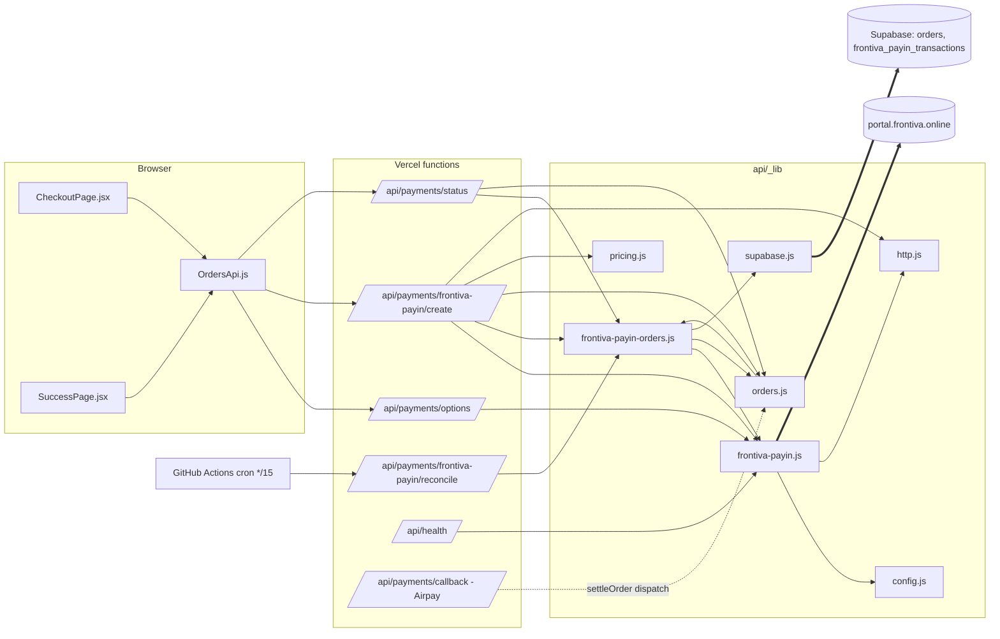
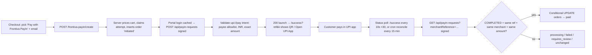

# 01 — Architecture: Frontiva PayIn

> **Update 2026-11-13 — multi-merchant implemented (uncommitted).** Frontiva PayIn slot 2 (`frontiva_payin_2`, off by default) and the AirPay MID 1 disablement are implemented; see [FRONTIVA-PAYIN-2-IMPLEMENTATION.md](FRONTIVA-PAYIN-2-IMPLEMENTATION.md). Line numbers below refer to `dff49ac` and may have shifted. Sections marked RECOMMENDED for multi-merchant are now implemented as described there.

> Scope: the existing Frontiva PayIn integration (gateway id `frontiva_payin`) as of 2026-11-13, commit `dff49ac`.
> All paths are relative to the repository root (`store/`). Line numbers refer to that commit.
>
> Tags: **VERIFIED** = read in code · **INFERRED** = reasoned from code, not directly proven · **UNKNOWN** = not determinable from the repo · **RECOMMENDED** = proposal, does not exist.

## 1. Repository architecture

| Layer | Technology | Location |
|---|---|---|
| Frontend | React (Vite), React Router, Tailwind/shadcn UI, `qrcode.react` for QR | `apps/web/` |
| Backend | Vercel Node serverless functions (one file = one route), ES modules, no framework | `api/` |
| Shared backend libs | Plain modules, dependency-injected for tests | `api/_lib/` |
| Database | Supabase Postgres, reached over PostgREST with `fetch` (no SDK on the server) | `api/_lib/supabase.js`, `supabase-schema.sql`, `migrations-*.sql` |
| Scheduler | GitHub Actions cron calling the reconcile endpoint | `.github/workflows/frontiva-payin-reconcile.yml` |
| Tests | `node --test` (backend + source-inspection tests), Vitest (frontend) | `tests/`, `apps/web/src/pages/__tests__/` |
| Deploy config | Vercel (`vercel.json`): build `apps/web`, rewrites, no `crons` key | `vercel.json` |

**VERIFIED** gateways in the codebase:

| Gateway | `orders.payment_gateway` | Server modules | Confirmation mechanism |
|---|---|---|---|
| Airpay merchant 1 / 2 / 3 | `NULL` or `'airpay'` (+ `airpay_merchant` 2/3) | `api/_lib/airpay.js`, `api/payments/create.js`, `callback.js` | Airpay IPN callback + server-side Order Confirmation; KKChat forwarding |
| SabPaisa | `'sabpaisa'` | `api/_lib/sabpaisa.js`, `api/payments/sabpaisa/create.js` | Return redirect + server-side enquiry |
| **Frontiva PayIn** | `'frontiva_payin'` | `api/_lib/frontiva-payin.js`, `api/_lib/frontiva-payin-orders.js`, `api/payments/frontiva-payin/*` | **Server-side status GET only** (no webhook) |
| Cash on Delivery | n/a (`payment_method = 'Cash on Delivery'`) | `apps/web/src/api/OrdersApi.js` (direct anon insert) | none |

Airpay MID_2 is currently hidden from checkout (`apps/web/src/api/OrdersApi.js:97`, `api/_lib/config.js:191`).

> Note: "Frontiva" is also the store's brand. Docs named `AIRPAY_FRONTIVA_*` / `FRONTIVA_DUAL_AIRPAY_*` are about **Airpay**, not PayIn.

## 2. Payment routing

### 2.1 Gateway discovery (frontend ← backend)

- **VERIFIED** `GET /api/payments/options` (`api/payments/options.js:21-26`) returns `{ merchants: [..], sabpaisa: bool }` and adds `frontiva_payin: true` **only** when `frontivaPayinAvailable()` is true.
- **VERIFIED** `frontivaPayinAvailable()` (`api/_lib/frontiva-payin.js:129-140`) = `FRONTIVA_PAYIN_ENABLED === 'true'` **and** config loads (email, password, expected merchant id, https base URL) **and** at least one allowed payee **and** Supabase service role present.
- **VERIFIED** `getPaymentGateways()` (`apps/web/src/api/OrdersApi.js:116-128`) appends `'frontiva_payin'` to the list when the flag is `true`. On any fetch failure the list is `[1]` (Airpay merchant 1 only), so PayIn is never offered on error.
- **VERIFIED** `CheckoutPage.jsx:43-50` holds the label list; `:121` filters it by what the server offered. Default selection is gateway `1` (`:58-59`).

### 2.2 Dispatch (backend)

There is **no single router**. Each gateway has its own create endpoint, and the browser calls the one matching the selected option:

- `'frontiva_payin'` → `POST /api/payments/frontiva-payin/create` (`CheckoutPage.jsx:198-234` → `OrdersApi.createFrontivaPayinPayment`).
- Settlement is dispatched centrally in `settleOrder()` (`api/_lib/orders.js:250-290`) by reading `order.payment_gateway` **from the server-written row**: `'frontiva_payin'` → `settleFrontivaPayinOrder()` (`:282-285`). Unknown gateway values are refused (`:287-290`).

## 3. Frontiva PayIn modules

| File | Role | Key exports |
|---|---|---|
| `api/_lib/frontiva-payin.js` (779 lines) | Provider client: config, feature flag, login + session cache, HMAC signature, create, status, UPI intent validation, settlement decision table | `FRONTIVA_PAYIN_GATEWAY`, `loadFrontivaPayinConfig`, `isFrontivaPayinConfigured`, `frontivaPayinEnabled`, `frontivaPayinAvailable`, `generateFrontivaSignature`, `rupeesToPaise`, `paiseToRupees`, `validateFrontivaCustomer`, `validateFrontivaAmount`, `getFrontivaSession`, `resetFrontivaSession`, `upiIntentProblem`, `resolveFrontivaLaunch`, `createFrontivaPayin`, `fetchFrontivaPayinStatus`, `classifyFrontivaStatus`, `decideFrontivaSettlement`, `logFrontivaPayin` |
| `api/_lib/frontiva-payin-orders.js` (317 lines) | Order lifecycle: attempt claim, metadata writes, QR restore, throttled idempotent settlement, reconciliation listing | `TRANSACTIONS_TABLE`, `claimCheckoutAttempt`, `recordTransaction`, `findFrontivaPayinIntent`, `confirmFrontivaPayin`, `settleFrontivaPayinOrder`, `closeFrontivaOrder`, `listFrontivaPayinDue`, constants `FRONTIVA_AUTO_CHECK_BUDGET`, `FRONTIVA_MIN_CHECK_INTERVAL_MS`, `FRONTIVA_REVIEW_AFTER_MS`, `FRONTIVA_QR_VALID_MS` |
| `api/payments/frontiva-payin/create.js` | `POST` create endpoint | `createHandler(deps)`, default handler |
| `api/payments/frontiva-payin/reconcile.js` | `GET/POST` cron sweep (Bearer `CRON_SECRET`) | `createHandler(deps)`, default handler |
| `api/payments/status.js` | Shared status read; for PayIn also restores the QR (`payment_intent`) | default handler, `maskCustomer` |
| `api/payments/options.js` | Shared gateway discovery | default handler |
| `api/health.js:111-116` | Reports `frontiva_payin: {configured, enabled, offered_at_checkout}` (booleans only, never part of `ok`) | — |
| `api/_lib/orders.js` | Shared: `createPendingOrder` (gateway branch `:94-123`), `settleOrder` dispatch (`:282-285`), `OPEN_STATUSES`, `findOrderByRef` | — |
| `api/_lib/http.js` | Shared: `fetchWithTimeout`, `logEvent` (+redaction keys `:31-34`), `scrubSecrets` (`FRONTIVA_PAYIN_PASSWORD` at `:169`), `isCronAuthorized` | — |
| `api/_lib/supabase.js` | PostgREST `select`/`insert` (with `on_conflict`)/`update` (`return=representation`) | — |
| `api/_lib/config.js` | `ConfigError`, `supabaseConfig().usingServiceRole` | — |
| `api/_lib/pricing.js` | `normalizeItems`, `normalizeCustomer`, `priceOrder` (server pricing) | — |
| `api/_lib/crypto.js:143` | `newOrderRef()` → `FRV` + base36 time + 10 hex | — |
| `apps/web/src/api/OrdersApi.js:103,116-128,298-383` | `FRONTIVA_PAYIN_GATEWAY`, `getPaymentGateways`, `createFrontivaPayinPayment`, `isFrontivaPayinLaunch`, `isUpiPayIntent`, `getOnlineOrder(ref, k)` | — |
| `apps/web/src/pages/CheckoutPage.jsx` | Gateway picker, PayIn-only email field (`:523-545`), attempt id (`:66,199`), submit (`:198-234`) | — |
| `apps/web/src/pages/SuccessPage.jsx` | QR render (`:295-340`), polling (`:187-223`), "Check Payment Status" (`:452-457`), cart clearing (`:225-234`) | — |
| `migrations-frontiva-payin.sql` | Widens `orders_payment_gateway_check`, creates `frontiva_payin_transactions` (+`upi_intent`), partial index | — |
| `supabase-schema.sql:138-171` | Standalone copy of the same objects | — |
| `.github/workflows/frontiva-payin-reconcile.yml` | `*/15 * * * *` POST to reconcile URL | — |
| `.env.example:147-163` | Variable template | — |
| `tests/frontiva-payin.test.js` (141 tests) | Unit, handler, source-inspection and QR round-trip tests | — |
| `apps/web/src/pages/__tests__/CheckoutPage.email.test.jsx` (10 tests) | Checkout email field behaviour | — |
| `docs/postman/frontiva-payin-status.postman_collection.json` | Manual status-check collection | — |
| `docs/FRONTIVA_PAYIN_*.md` | Earlier integration report, runbook, validation (partly superseded: they predate the switch to UPI intent) | — |

**Not present (VERIFIED):** no PayIn webhook/callback route (`tests/frontiva-payin.test.js:808-815` asserts the folder only holds `create.js` and `reconcile.js`), no KKChat forwarding, no Airpay/SabPaisa imports from PayIn modules (test `:817-826`).

**Active vs disabled:** all PayIn code above is deployed (per `docs/FRONTIVA_PAYIN_RELEASE_RUNBOOK.md:3`, not independently verified) and is **gated off** by `FRONTIVA_PAYIN_ENABLED` (local `.env` = `false`; production value **UNKNOWN**). `FRONTIVA_PAYIN_CLIENT_SECRET`, `FRONTIVA_PAYIN_MERCHANT_ID`, `FRONTIVA_PAYIN_LAUNCH_HOSTS` are obsolete names that no code reads (test `:1112-1122`).

## 4. Dependency map

Direct dependents of `frontiva-payin.js`: `frontiva-payin-orders.js`, `orders.js`, `options.js`, `health.js`, `frontiva-payin/create.js`.
Indirect dependents (via `orders.js#settleOrder`): `status.js`, `callback.js` (Airpay), `reconcile.js` (main) — any of them can trigger a PayIn status check for a `frontiva_payin` order. **VERIFIED** for `status.js`; **INFERRED** for `callback.js`/main reconcile (they call `settleOrder`, which dispatches; main reconcile filters to Airpay-only rows when the `payment_gateway` column exists, `api/payments/reconcile.js:46`).

## 5. High-level flow (actual)

There is no "order completion" step beyond `payment_status = 'paid'`: no email, no webhook forward, no fulfilment trigger (VERIFIED by absence in PayIn modules).
