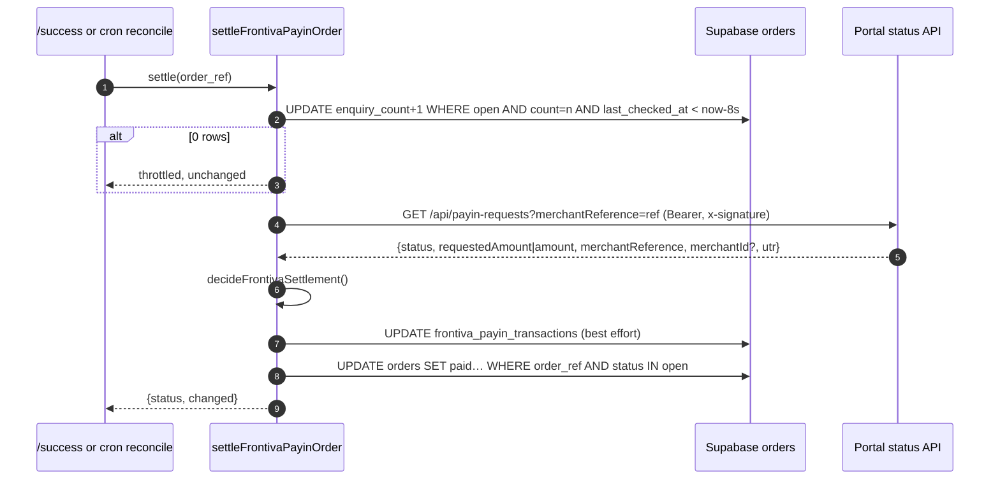
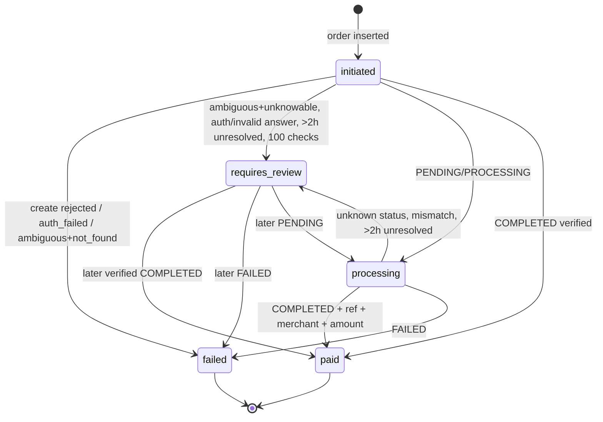

# 02 — Payment Lifecycle: Frontiva PayIn

> **Update 2026-11-13 — multi-merchant implemented (uncommitted).** Frontiva PayIn slot 2 (`frontiva_payin_2`, off by default) and the AirPay MID 1 disablement are implemented; see [FRONTIVA-PAYIN-2-IMPLEMENTATION.md](FRONTIVA-PAYIN-2-IMPLEMENTATION.md). Line numbers below refer to `dff49ac` and may have shifted. Sections marked RECOMMENDED for multi-merchant are now implemented as described there.

Paths relative to `store/`. Tags: **VERIFIED / INFERRED / UNKNOWN / RECOMMENDED**.

## 1. Checkout gateway selection

**VERIFIED**
1. `CheckoutPage` calls `getPaymentGateways()` once on mount (`apps/web/src/pages/CheckoutPage.jsx:84-98`). The option `{ id: 'frontiva_payin', label: 'Pay with Frontiva PayIn' }` (`:49`) appears only if the server listed it.
2. The picker is rendered only when more than one online option exists (`:486`).
3. Choosing PayIn reveals a required **Email Address** field directly under the picker (`:523-545`), held in its own state `payinEmail` so no other gateway's request changes.
4. Client validation (`:159-166`): email required, regex `^[^\s@<>"']+@[^\s@<>"']+\.[A-Za-z]{2,}$` (same regex as server `isValidEmail`).
5. **Conditions for PayIn to be selectable**: `FRONTIVA_PAYIN_ENABLED=true`, email/password/expected-merchant-id set, base URL is an https origin, ≥1 allowed payee, `SUPABASE_SERVICE_ROLE` present, `/api/payments/options` reachable.
6. **Fallback**: options fetch fails → gateways `[1]` (Airpay 1 only).

## 2. Order creation (`POST /api/payments/frontiva-payin/create`)

`api/payments/frontiva-payin/create.js:56-208`, in order:

| # | Step | Code | Failure → response |
|---|---|---|---|
| 1 | Method must be POST | `:57` | 405 |
| 2 | `frontivaPayinAvailable()` | `:64` | 503 `frontiva_payin_unavailable` |
| 3 | Parse body; `attempt_id` must be a UUID v1–8 | `:69-75` | 400 `invalid_attempt` |
| 4 | `normalizeItems`, `normalizeCustomer` (pricing.js), `validateFrontivaCustomer` (name 2–100 chars, phone 10 digits, valid email) | `:78-80` | 400 + message (+`invalid_items`) |
| 5 | `loadFrontivaPayinConfig()` | `:81` | 503 (ConfigError) |
| 6 | `priceOrder(items)` — **server-side price**; browser prices/merchant/gateway ignored | `:83` | 400 / 502 |
| 7 | `validateFrontivaAmount` — integer paise ≥ 100 | `:84` | 400 |
| 8 | `orderRef = newOrderRef()` | `:86` | — |
| 9 | `claimCheckoutAttempt` → INSERT `frontiva_payin_transactions` (`create_state='requested'`) with `on_conflict=checkout_attempt_id`, ignore duplicates | `:88-104`, `frontiva-payin-orders.js:47-73` | duplicate → 409 `duplicate_attempt` + existing `order_ref` |
| 10 | `createPendingOrder({gateway:'frontiva_payin', orderRef})` → INSERT `orders` (`payment_method='Online Payment'`, `status=payment_status='initiated'`, `enquiry_count=0`, `total` in rupees) | `:106-112`, `orders.js:94-123` | 502 `database` |
| 11 | `createFrontivaPayin(...)` | `:114` | see §3 |

Amounts: the pricing module returns `totalInCents` which is actually **paise** (INR; the name is inherited). `orders.total = totalInCents / 100`. The transaction row stores `amount_in_paise`.

The customer **email is not stored** anywhere in our DB (VERIFIED: not in either insert); it is only sent to the provider.

## 3. Payment initiation

`createFrontivaPayin()` (`api/_lib/frontiva-payin.js:517-603`):

1. `signedRequest()` (`:394-421`) obtains a session via `getFrontivaSession()` (login cached per function instance, `:249-381`), then sends
   `POST {baseUrl}/api/payin-requests` with headers `Authorization: Bearer <accessToken>`, `x-signature: HMAC-SHA256(clientSecret, merchantReference) hex`, `Content-Type: application/json`, `Accept: application/json`; timeout 15 s.
   Body: `{ merchantReference: orderRef, amount: <rupees number>, currency: 'INR', paymentMode: 'UPI_INTENT', customer: {name, email, phone} }`.
2. 401/403 on the first try → session dropped, re-login, sent **once more** (safe: refused before processing). No other retry of the POST.
3. Result classification:

| Provider outcome | `kind` | Endpoint action |
|---|---|---|
| Login failed (any `FrontivaPayinError`) | `auth_failed` | tx `create_state=auth_failed`; order → `failed`; **503** |
| 401/403 after retry | `auth_failed` | same |
| Network error / timeout on POST | `ambiguous` | see below |
| 5xx, 409, 429 | `ambiguous` | see below |
| Other 4xx | `rejected` | tx `rejected`; order → `failed`; **502** |
| 2xx but unreadable / no `id` / `success:false` | `ambiguous` | see below |
| 2xx but `merchantReference`, amount or `merchantId` ≠ ours | `ambiguous` | see below |
| 2xx, matches, status not PENDING/PROCESSING | `created`, `launch=null` | tx `created_not_launched`; **502** (no QR) |
| 2xx, matches, pending, intent fails validation | `created`, `launch=null` | tx `created_not_launched`; **502** |
| 2xx, matches, pending, intent valid | `created`, `launch={type:'upi_intent', url}` | tx `created` + `upi_intent`; **200** |

**Ambiguous handling** (`create.js:125-156`): never re-POST. One status GET:
- `not_found` → tx `not_created`, order `failed`.
- found (same ref) → tx `created_not_launched` (+`portal_request_id`), order left **open** for reconciliation.
- anything else → tx `ambiguous`, order → `requires_review`.
The customer always gets 502 "You have not been charged" in the ambiguous case.

## 4. UPI intent and QR

**VERIFIED** — QR type: **dynamic, client-side generated** QR of the provider's `upi://pay?...` intent (`SuccessPage.jsx:308-318`, `QRCodeSVG`, level M, 320 px, quiet zone 4). No server-side image, no static QR.

Server validation `upiIntentProblem()` (`frontiva-payin.js:443-471`), all must pass:
- string ≤ 1024 chars, printable ASCII only, starts with `upi://pay?`, no `#`, valid `%XX` encoding;
- no duplicate parameter keys (case-insensitive, after decoding — blocks `p%61=` tricks);
- `pa` is a VPA (`handle@psp`) **in `FRONTIVA_PAYIN_ALLOWED_PAYEES`** (case-insensitive);
- `cu === 'INR'`;
- `am` matches `^\d{1,10}(\.\d{1,2})?$` and equals the order amount **exactly in paise**.
- `tr` is deliberately **not** compared to `merchantReference` (provider sample differs). `pn`, `tn`, `mc` are not checked.
- `resolveFrontivaLaunch()` (`:484-492`) also refuses a `paymentMode` other than `UPI_INTENT`; `url` is ignored (a `data:text/html` URL is never forwarded — test `:460`).

The intent is used **byte-for-byte** (never rebuilt). Browser re-checks the shape (`OrdersApi.isUpiPayIntent`, `:359-361`) before rendering.

Display:
- Desktop: QR only. Mobile (`useIsMobile`): QR + "Open UPI App" anchor with `href=intent` (`SuccessPage.jsx:327-338`); never auto-opened (test `:905`).
- The page shows the amount and the hard-coded text "…to **Frontiva Trading Private Limited**" (`:321-324`). ⚠ merchant-specific; see doc 07.
- QR is shown only while `payment_status ∈ {initiated, processing}` and the order is ≤ 30 min old (`FRONTIVA_QR_VALID_MS`, mirrored in `PAYIN_QR_VALID_MS`).

Binding QR ↔ backend request: the intent comes only from (a) the 200 create response (passed in router history state), or (b) `GET /api/payments/status?ref=…&k=<attempt_id>` which returns the stored `upi_intent` only when `order_ref` **and** `checkout_attempt_id` match a row with `create_state='created'` (`frontiva-payin-orders.js:110-138`). A refresh therefore never creates a second PayIn.

## 5. Payment status verification

**Mechanisms implemented (VERIFIED):**

| Mechanism | Trigger | Code |
|---|---|---|
| Status-on-read | every `GET /api/payments/status` while order is `initiated`/`processing` | `status.js:65-71` → `settleOrder` |
| Frontend polling | `/success` polls every 10 s, max 30 polls (5 min) while pollable | `SuccessPage.jsx:187-223` |
| Manual check | "Check Payment Status" button (resets poll count) | `SuccessPage.jsx:142-156, 452` |
| Backend reconciliation | `GET/POST /api/payments/frontiva-payin/reconcile`, Bearer `CRON_SECRET`, scheduled by GitHub Actions every 15 min | `frontiva-payin/reconcile.js`, `.github/workflows/frontiva-payin-reconcile.yml` |
| Webhook / callback | **Not implemented by decision** | — |

All paths converge on `settleFrontivaPayinOrder()` (`frontiva-payin-orders.js:163-256`):

1. Order not open → return unchanged.
2. `enquiry_count ≥ 100` → move to `requires_review` (once).
3. **Claim** the check: conditional `UPDATE orders SET enquiry_count=n+1, last_checked_at=now WHERE order_ref=… AND gateway=frontiva_payin AND status open AND enquiry_count=n AND (last_checked_at IS NULL OR < now-8s)`. Zero rows → "check throttled" (no provider call).
4. `fetchFrontivaPayinStatus(orderRef)` → `GET {baseUrl}/api/payin-requests?merchantReference=<ref>` signed with the same HMAC; one retry on transport error; handles `{success,data}`, bare record, or array (exactly one row with our reference, else `invalid`).
5. `decideFrontivaSettlement()` (`frontiva-payin.js:734-772`).
6. Metadata write to `frontiva_payin_transactions` (best-effort).
7. Transition via conditional UPDATE filtered on open statuses (the idempotency barrier, `:259-275`).

### Status mapping (real names)

Provider → `classifyFrontivaStatus` (`:716-724`):

| Provider `status` | Class | Local decision |
|---|---|---|
| `COMPLETED` | success | `paid` **only if** ref matches, merchantId matches (when present) and amount (paise) equals `round(orders.total*100)`; otherwise `requires_review` |
| `PENDING`, `PROCESSING` | pending | `processing` |
| `FAILED` | failed | `failed` |
| anything else (e.g. `EXPIRED`, `CANCELLED` — **UNKNOWN** whether the provider ever sends these) | unknown | `requires_review` |

Lookup outcomes:

| Outcome | Decision |
|---|---|
| `not_found`, `unavailable` (timeout, 429, 5xx) | no change; after 2 h since creation → `requires_review` |
| `auth_error`, `not_configured`, `invalid` | `requires_review` immediately |

`requires_review` is still an open status: reconciliation keeps checking it (until 100 checks) and it can still become `paid` or `failed`. `/success` does **not** re-check it on read (`status.js:22`).

### What proves success
A server-side, signed status GET answer whose `merchantReference` equals our `order_ref`, `status === 'COMPLETED'`, `merchantId` equals the logged-in portal merchant (check skipped if the status response omits `merchantId`), and amount equals the order total. The frontend can never mark paid through the API. ⚠ The `orders` table itself is anon-writable (see doc 06, F-01).

## 6. Successful payment

`transition()` patch (`frontiva-payin-orders.js:248-255`): `payment_status = status = 'paid'`, `updated_at`, `verified_at`, `paid_at`, `gateway_txn_id = utr` (if any). Transaction row gets `provider_status`, `last_verified_at`, `portal_request_id`, `provider_utr`, `last_error=null`.

- No notification, email, webhook forward or fulfilment hook (VERIFIED absent).
- `/success` shows the settled view; cart is cleared only when `paymentStatus === 'paid'` (`SuccessPage.jsx:225-234`).
- **Authoritative source**: the provider status endpoint; locally, `orders.payment_status`.

## 7. Failure / interruption matrix

| Scenario | Behaviour (VERIFIED unless tagged) |
|---|---|
| Invalid credentials | login 400/401/403 → `auth_failed`; order `failed`; 503; 30 s login cooldown per instance |
| Wrong merchant id | login `merchant_mismatch` → `auth_failed`, fail closed |
| Provider timeout on create | `ambiguous` → status lookup decides (§3) |
| Invalid UPI intent | `created_not_launched`, customer gets 502, PayIn reconciled to its end (could later be `failed`/expired at provider) |
| Unsupported UPI app | **UNKNOWN** — no app-specific handling; desktop users scan with any app |
| QR generation failure | **INFERRED** — `QRCodeSVG` throws only for oversize data; ≤1024 chars is within capacity (test `:871-895` round-trips samples) |
| User abandons | order stays `initiated`; reconcile checks after 10 min grace; provider PENDING → `processing`; after 2 h unresolved → `requires_review`; never auto-failed by silence |
| Paid but page closed | reconcile marks `paid` on next run (≤ ~15–25 min, depends on GitHub schedule) |
| Provider success, DB update fails | transition throws → 502 / reconcile error; order still open; next check re-asks provider (idempotent) |
| Duplicate submit of same attempt | 409 `duplicate_attempt` → browser goes to `/success?ref=<existing>` |
| Retry after failure | browser discards the attempt id after a non-duplicate error (`CheckoutPage.jsx:222`) → new attempt, new order, new PayIn |
| Metadata write fails after create | customer still gets the QR; QR restore after refresh may not work (history state fallback only) |

## 8. Sequence — initiation

```mermaid
sequenceDiagram
  autonumber
  participant B as Browser (Checkout)
  participant C as /frontiva-payin/create
  participant DB as Supabase
  participant P as portal.frontiva.online
  B->>C: POST {customer, email, items, attempt_id}
  C->>C: available()? validate, priceOrder (server)
  C->>DB: INSERT frontiva_payin_transactions (on_conflict attempt → ignore)
  alt duplicate attempt
    C-->>B: 409 duplicate_attempt {order_ref}
  end
  C->>DB: INSERT orders (gateway=frontiva_payin, initiated)
  C->>P: POST /api/auth/user/login (if no cached session)
  P-->>C: accessToken, user.clientSecret, user.merchantId (must equal expected)
  C->>P: POST /api/payin-requests (Bearer, x-signature=HMAC(ref))
  P-->>C: {id, merchantId, merchantReference, amount, status:PENDING, intent:"upi://pay?...", url:null}
  C->>C: match ref/amount/merchant; upiIntentProblem()
  C->>DB: UPDATE tx (created, portal ids, upi_intent)
  C-->>B: 200 {order_ref, order_id, total_in_cents, launch:{type:'upi_intent', url}}
  B->>B: navigate /success?ref=…&k=attempt_id (state: intent)
```

## 9. Sequence — verification



## 10. Order status transitions


