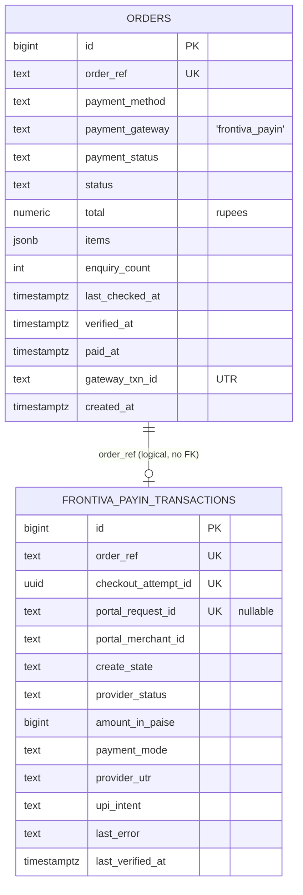

# 04 — Database Schema: Frontiva PayIn

> **Update 2026-11-13 — multi-merchant implemented (uncommitted).** Frontiva PayIn slot 2 (`frontiva_payin_2`, off by default) and the AirPay MID 1 disablement are implemented; see [FRONTIVA-PAYIN-2-IMPLEMENTATION.md](FRONTIVA-PAYIN-2-IMPLEMENTATION.md). Line numbers below refer to `dff49ac` and may have shifted. Sections marked RECOMMENDED for multi-merchant are now implemented as described there.

Sources: `migrations-frontiva-payin.sql`, `supabase-schema.sql`, `migrations-sabpaisa.sql`, and the code that reads/writes. The **live** database was not inspected (read-only rule); whether the migration has run in production is stated as "already applied by the owner" in `docs/FRONTIVA_PAYIN_RELEASE_RUNBOOK.md:84` — **UNKNOWN** to this review. Tags: **VERIFIED / INFERRED / UNKNOWN / RECOMMENDED**.

## 1. `public.frontiva_payin_transactions` (PayIn-only)

`migrations-frontiva-payin.sql:28-67` — **VERIFIED**

| Column | Type | Null | Default | Written by | Meaning |
|---|---|---|---|---|---|
| `id` | `bigint identity` | no | generated | — | PK |
| `order_ref` | `text` | no | — | `claimCheckoutAttempt` | = `orders.order_ref` = provider `merchantReference`. **Not a FK** (row written before the order) |
| `checkout_attempt_id` | `uuid` | no | — | `claimCheckoutAttempt` | browser UUID per attempt; also the QR-restore key `k` |
| `portal_request_id` | `text` | yes | — | create (success / ambiguous-found), settlement | provider `id` |
| `portal_merchant_id` | `text` | yes | — | create success only | provider `merchantId` of the session |
| `create_state` | `text` | no | `'requested'` | create | `requested` · `created` · `created_not_launched` · `rejected` · `auth_failed` · `ambiguous` · `not_created` (no CHECK constraint) |
| `provider_status` | `text` | yes | — | create, settlement | last provider status, upper-cased |
| `amount_in_paise` | `bigint` | no | — | claim | `CHECK (amount_in_paise > 0)` |
| `payment_mode` | `text` | no | — | claim | `'UPI_INTENT'` |
| `provider_utr` | `text` | yes | — | settlement | UTR from status |
| `last_error` | `text` | yes | — | create, settlement | sanitized reason ≤120 chars, never a provider body |
| `last_verified_at` | `timestamptz` | yes | — | settlement | last answered check |
| `upi_intent` | `text` | yes | — | create success | validated `upi://pay` URI (added by a later idempotent `ALTER`, `:65`) |
| `created_at` / `updated_at` | `timestamptz` | no | `now()` | — / `recordTransaction` | |

Indexes / constraints:
- `frontiva_payin_transactions_attempt_key` UNIQUE (`checkout_attempt_id`) — idempotency of checkout submissions.
- `frontiva_payin_transactions_order_ref_key` UNIQUE (`order_ref`) — exactly **one** PayIn per order.
- `frontiva_payin_transactions_portal_request_key` UNIQUE (`portal_request_id`) WHERE not null.
- **RLS enabled, no policy** → only the service role (server) can read/write. Hence `frontivaPayinAvailable()` requires `SUPABASE_SERVICE_ROLE`.

Secrets and email: never stored (VERIFIED — no such column).

## 2. `public.orders` columns used by PayIn

| Column | Origin | PayIn use |
|---|---|---|
| `id` | base | `order_id` in create response; `FRV-00001` display number |
| `order_ref` text, UNIQUE index `orders_order_ref_key` | base (`supabase-schema.sql:86,175`) | key for everything |
| `customer_name`, `phone`, `address`, `landmark` | base | written at create |
| `payment_method` | base | `'Online Payment'` |
| `status`, `payment_status` | base / online migration | mirrored lifecycle state |
| `total numeric(10,2)` | base | rupees; expected amount = `round(total*100)` paise |
| `items jsonb` | base | server-priced lines |
| `payment_gateway text` + `orders_payment_gateway_check` | SabPaisa migration, widened by PayIn migration | `'frontiva_payin'` |
| `enquiry_count integer` (`>= 0` check) | SabPaisa migration | check counter (budget 100), optimistic-lock token for the claim |
| `last_checked_at timestamptz` | SabPaisa migration | throttle (8 s) and backoff |
| `verified_at`, `paid_at` | online migration | set on settlement |
| `gateway_txn_id` | SabPaisa migration | UTR on settlement |
| `airpay_merchant` | Airpay migration | **not written** for PayIn |
| `frontiva_payin_merchant` | `migrations-frontiva-payin-merchants.sql` (**not yet applied**) | PayIn slot. Written only for slot ≥ 2, in the order INSERT; NULL = slot 1. Check: NULL, or `payment_gateway='frontiva_payin'` and a value of 2–99. Read by `frontivaSlotForOrder()` |
| `created_at` | base | grace period, 2 h review window, 30 min QR validity |

Partial index `orders_frontiva_payin_open_idx` on `(last_checked_at nulls first) WHERE payment_gateway = 'frontiva_payin'` (`migrations-frontiva-payin.sql:72-74`).

RLS on `orders`: `supabase-schema.sql:63-65` defines policy **"prototype orders access" FOR ALL USING (true) WITH CHECK (true)** — the anon key (shipped to the browser as `VITE_SUPABASE_ANON_KEY`) can read and **update** any order. COD orders are inserted directly by the browser (`apps/web/src/api/OrdersApi.js:48`). Whether this policy is still live in production is **UNKNOWN**; the runbook acknowledges it (`docs/FRONTIVA_PAYIN_RELEASE_RUNBOOK.md:131`). See doc 06 F-01.

## 3. Status values

`orders.payment_status` (shared with other gateways): `initiated`, `processing`, `requires_review` (all **open**, `OPEN_STATUSES` `orders.js:29`), `paid`, `failed` (terminal). There is no `expired`/`cancelled` state. Mapping from provider statuses: doc 02 §5.

## 4. ER diagram

`payment_events` (Airpay callback audit table) is **not** used by PayIn.

## 5. Concurrency and transactions

- No multi-statement DB transactions are used (PostgREST single statements). **VERIFIED**
- Attempt idempotency: `INSERT … ON CONFLICT (checkout_attempt_id) DO NOTHING` (`Prefer: resolution=ignore-duplicates`), then select the existing row.
- Check claim: optimistic `UPDATE … WHERE enquiry_count = n AND last_checked_at < now-8s` — at most one concurrent provider check per order.
- Terminal transition: `UPDATE … WHERE payment_status IN (open)` — paid applied at most once; a losing writer re-reads and reports "already settled".
- Gaps (**INFERRED**): the claim row and the order row are separate writes; if the order INSERT fails after the claim, an orphan transaction row remains (harmless; the browser gets 502 and drops the attempt id). `recordTransaction` is best-effort: transaction metadata can lag the order state.

## 6. Multiple attempts per order

**VERIFIED: not supported.** `order_ref` is UNIQUE in the transaction table; every retry is a new attempt → new `order_ref` → new order row → new PayIn. Abandoned attempts remain as separate open orders until reconciled.

## 7. Multi-merchant considerations

- **Nothing records which PayIn merchant account an order belongs to at order-creation time.** `portal_merchant_id` is written only after a successful create, best-effort, and is never read back by settlement. Settlement always uses the single env-configured account.
- `orders_payment_gateway_check` allows only `'frontiva_payin'` (no `_2`).
- `portal_request_id` uniqueness is global; two portal accounts could in theory issue the same numeric id (**UNKNOWN**) → the unique index would reject the second write (best-effort write, so it would only lose metadata, not break payment).
- **IMPLEMENTED 2026-11-13** (migration prepared, not applied): `orders.frontiva_payin_merchant smallint NULL`. The optional `frontiva_payin_transactions.merchant_slot` was **not** added: the order column is the single source of truth, and `portal_merchant_id` already records the account the PayIn was created under.
- Original recommendation (doc 07): add `orders.frontiva_payin_merchant smallint NULL` (NULL = existing merchant 1; check `between 2 and 99`), written in the order INSERT before any provider call; optionally `frontiva_payin_transactions.merchant_slot smallint`. Additive, nullable, no backfill.
