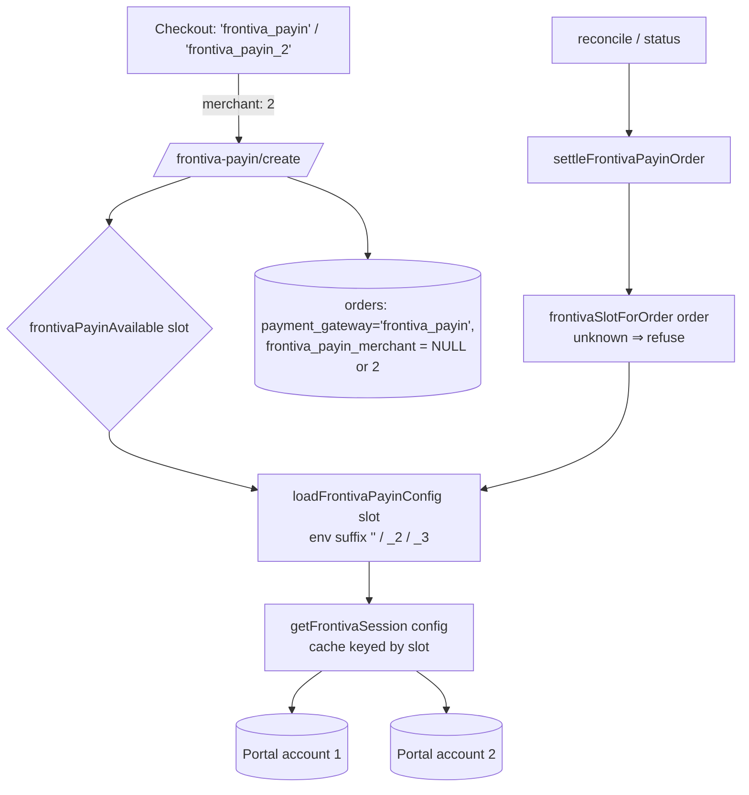

# 07 — Multi-Merchant Design: Frontiva PayIn

> **Update 2026-11-13 — multi-merchant implemented (uncommitted).** Frontiva PayIn slot 2 (`frontiva_payin_2`, off by default) and the AirPay MID 1 disablement are implemented; see [FRONTIVA-PAYIN-2-IMPLEMENTATION.md](FRONTIVA-PAYIN-2-IMPLEMENTATION.md). Line numbers below refer to `dff49ac` and may have shifted. Sections marked RECOMMENDED for multi-merchant are now implemented as described there.

Everything in §3–§6 is **RECOMMENDED** (not implemented). Paths relative to `store/`.

## 0. Status (2026-11-13)

Option B is **implemented** (uncommitted; see [FRONTIVA-PAYIN-2-IMPLEMENTATION.md](FRONTIVA-PAYIN-2-IMPLEMENTATION.md)). L1–L10 below are resolved:

- per-slot config, flags and availability;
- a per-slot session map with a merchant-ID assertion;
- the `orders.frontiva_payin_merchant` column;
- additive `/options` and health keys;
- a `frontiva_payin_2` checkout option;
- a payee name supplied by the server;
- `PASSWORD_2` scrubbing;
- updated tests.

Deviations from §5–§6:

1. A slot ≥ 2 is also refused when it shares slot 1's **merchant ID**, not only its email. The provider question in §8 is still UNKNOWN.
2. A stored `portal_merchant_id` that differs from the slot's expected ID parks the order in review **without** a provider call.
3. The reconcile listing does not select the new column, so deploying before the migration cannot break slot-1 reconciliation.

## 1. Limitations before implementation (VERIFIED at `dff49ac`)

| # | Limitation | Where |
|---|---|---|
| L1 | Config reads fixed, unsuffixed env names; no merchant parameter | `frontiva-payin.js:75-107` |
| L2 | One global session cache / login cooldown for the process | `frontiva-payin.js:249-381` |
| L3 | `frontivaPayinEnabled()` / `frontivaPayinAvailable()` are global booleans | `:120-140` |
| L4 | Orders carry no PayIn merchant identifier; settlement uses current env | `orders.js:94-123`, `frontiva-payin-orders.js:205` |
| L5 | `options` returns a single `frontiva_payin: true` | `options.js:25` |
| L6 | Frontend has one PayIn option id and label | `OrdersApi.js:103,127`, `CheckoutPage.jsx:49` |
| L7 | Hard-coded payee legal name on QR page | `SuccessPage.jsx:321-324` |
| L8 | `scrubSecrets` lists only `FRONTIVA_PAYIN_PASSWORD` | `http.js:169` |
| L9 | Health reports one PayIn block | `health.js:111-116` |
| L10 | Tests pin the exact env-name set and forbid the word `merchant` in `createFrontivaPayinPayment` | `tests/frontiva-payin.test.js:1112-1122, 828-833` |

What already works for any number of merchants: the HMAC function, intent validation (takes `allowedPayees` as input), the create/status functions (take `config` as input), `decideFrontivaSettlement`, the idempotent transition, reconciliation listing (by gateway), QR restore, and `settleFrontivaPayinOrder` already accepts `deps.frontivaConfig` (`frontiva-payin-orders.js:205`).

## 2. Precedent in this codebase

Airpay already solved the same problem (`api/_lib/config.js:39-45,100-165`, `orders.js:49-88,151-165`):
- merchant **number** 1/2/3; env suffix `''`, `_2`, `_3`;
- `orders.airpay_merchant` written only for merchants ≠ 1 (NULL = 1), so merchant 1's INSERT stays byte-identical to production;
- `merchantForOrder(order)` returns null for unknown values and settlement then refuses — never guesses;
- frontend option ids are the numbers.

## 3. Option A — separate gateways (`frontiva_payin_2`, `frontiva_payin_3`, …)

| Needs | Detail |
|---|---|
| DB | Widen `orders_payment_gateway_check` per new id; new partial index per id |
| Backend | Every `=== FRONTIVA_PAYIN_GATEWAY` site must learn the new ids: `orders.js:95, :282`, `frontiva-payin-orders.js:37, :114, :155, :306`, reconcile listing; plus a gateway→config map |
| Frontend | New id in `OrdersApi`, `CheckoutPage`, and `SuccessPage.jsx:129, :189` (`isPayin`, polling list) |
| Reuse | Still needs the shared adapter, or ~1100 lines are copied |

Pros: strongest visual separation in data; disabling = per-gateway. Cons: largest surface; any missed equality check makes the new gateway's orders hit `unknown gateway` (safe but stuck); schema change per merchant.

## 4. Option B — shared adapter, merchant slots (**recommended**)

`payment_gateway` stays `'frontiva_payin'` for all PayIn merchants. A new nullable `orders.frontiva_payin_merchant` holds the slot (NULL = slot 1 = today's account).



Pros: mirrors Airpay; DB constraint, reconciliation, status endpoint, success page detection and dispatch unchanged; slot 1 behaviour and insert byte-identical; one adapter to maintain. Cons: one additive column; slot must be resolved everywhere config is loaded.

**Recommendation: Option B** — smallest change, compatible with existing rows (NULL = slot 1), same pattern engineers already know from Airpay.

## 5. Merchant isolation strategy

1. **Per-slot config**: `loadFrontivaPayinConfig(slot = 1)` reads `FRONTIVA_PAYIN_<ROLE>` for slot 1 and `FRONTIVA_PAYIN_<ROLE>_<N>` for N ≥ 2 (`EMAIL`, `PASSWORD`, `EXPECTED_MERCHANT_ID`, `ALLOWED_PAYEES`, `ENABLED`, optional `BASE_URL`, optional non-secret `PAYEE_NAME`). Return `slot` in the config object.
2. **Per-slot session**: cache, in-flight login, cooldown and last error keyed by slot. Before using a session assert `session.merchantId === config.expectedMerchantId`.
3. **Order binding at creation**: slot written in the same INSERT that creates the order, before any provider call.
4. **Settlement binding**: `frontivaSlotForOrder(order)`: NULL → 1; known configured slot → that slot; anything else → return unchanged with reason `unknown frontiva merchant` and log. **Never default a non-null unknown value to slot 1.**
5. **Cross-checks**: if `frontiva_payin_transactions.portal_merchant_id` is set and ≠ `config.expectedMerchantId` → `requires_review`; if the status answer has `portalRequestId` and the stored one differs → `requires_review`.
6. **Disable ≠ unconfigure**: `ENABLED_<N>=false` stops new payments for slot N only; its credentials must stay until all its orders are terminal.
7. **Config sanity**: two slots must not share `EMAIL`; if two slots share `EXPECTED_MERCHANT_ID` the merchant checks cannot tell them apart (allowed only if the provider confirms separate accounts — **UNKNOWN**).
8. **Per-slot payee allowlist**: a slot's QR is validated only against its own `ALLOWED_PAYEES`.

## 6. Gateway identifier design

| Layer | Slot 1 (existing) | Slot N |
|---|---|---|
| `orders.payment_gateway` | `frontiva_payin` | `frontiva_payin` |
| `orders.frontiva_payin_merchant` | `NULL` | `N` |
| Env names | `FRONTIVA_PAYIN_EMAIL` … | `FRONTIVA_PAYIN_EMAIL_N` … |
| `/options` | `frontiva_payin: true` (kept for compatibility) | `frontiva_payin_merchants: [1, N]` (new key) |
| Checkout option id | `'frontiva_payin'` | `'frontiva_payin_N'` |
| Create request body | no `merchant` field | `merchant: N` |
| Health | `frontiva_payin: {...}` | `frontiva_payin_merchants: { "N": {...} }` |

## 7. Backward compatibility requirements

- Existing open PayIn orders (NULL slot) keep settling with today's env names — no rename of existing variables.
- Slot-1 order INSERT and create request body unchanged (no new keys) so existing tests and production behaviour stay identical.
- `/options` keeps `frontiva_payin: true` semantics; new keys are additive and absent when no extra slot is available.
- No backfill, no reinterpretation of existing rows, no constraint narrowing.
- Airpay, SabPaisa, COD code paths untouched.

## 8. Migration considerations

```sql
-- RECOMMENDED, additive, idempotent. Not executed.
alter table public.orders add column if not exists frontiva_payin_merchant smallint;
alter table public.orders drop constraint if exists orders_frontiva_payin_merchant_check;
alter table public.orders add constraint orders_frontiva_payin_merchant_check
  check (frontiva_payin_merchant is null
         or (payment_gateway = 'frontiva_payin' and frontiva_payin_merchant between 2 and 99));
notify pgrst, 'reload schema';
```
Run before deploying code that writes the column. Rollback: disable slot N; leave the column (dropping it would orphan slot-N orders' merchant binding).

Open provider questions (**UNKNOWN**, must be answered before go-live): does each merchant have its own portal login? Do different accounts return different `merchantId`s? Is the status GET scoped to the logged-in merchant? Do accounts share payee VPAs? Rate limits per account?
